# VQ-VAE for Generating Privacy-Preserving Synthetic Hip MRI Cohorts

## Project Description
In this project, I aim to address the challenges of clinical data scarcity and stringent patient privacy laws by using a Vector Quantised Variational Autoencoder (VQ-VAE) to synthesise realistic 2D hip MRI cohorts. Due to strict patient confidentiality laws, medical imaging is frequently restricted from open research, leading to limited clinical datasets. This constrains the development of robust models and clinical assessment tools. To overcome these limitations, I developed a generative modelling pipeline pairing a VQ-VAE with a Gated PixelCNN prior, benchmarked against a baseline Variational Autoencoder (VAE). The primary objective is to evaluate whether discrete representation learning can faithfully capture authentic physiological tissue boundaries and anatomical structures in hip MRI scans. By generating realistic synthetic MRI cohorts that preserve patient privacy, I aim to expand scarce medical imaging datasets and facilitate data augmentation for downstream research.

## Models
### VQ-VAE
A VQ-VAE is a type of autoencoder that maps high-dimensional data into a discrete latent space. The model first compresses the input through an encoder into continuous spatial feature maps. Then, these features are quantised by mapping each vector to its nearest neighbour in a learned discrete codebook before a decoder reconstructs the input from these quantised features. This structure is shown on the left in Figure 1 for an image. The output of the encoder $z_e(x)$ is mapped to the nearest point $e_i$ for some $1 \le i \le k$. The right of Figure 1 shows the embedding space for the codebook, showing the assignment of $z_e(x)$ to $e_i$ that minimises the Euclidean distance.

![Figure 1: Architecture of the VQ-VAE [1]](README_images/VQ_VAE_Architecture.png)
Figure 1: Architecture of the VQ-VAE [1]

The fundamental difference between a VQ-VAE and a VAE is this latent space. The VAE's continuous Gaussian sampling is replaced with this deterministic vector quantisation step. This largely mitigates the posterior collapse that often occurs with VAEs as the model is not forced into an often uninformative Gaussian prior [1]. Furthermore, the discrete representation of the latent space means there is no continuous blending which would produce impossible interpolation artifacts. This is extremely important for the generation of hip MRI scans as valid anatomical structures are discrete and intermediate states between them do not exist in reality.

### PixelCNN
Because the VQ-VAE only compresses the input into a discrete grid of codebook indices, an autoregressive model is required to learn the distribution over these latent tokens to synthesise new data. Following the original paper [1], I use a PixelCNN to model this prior.

A PixelCNN is an autoregressive model that facotorises the joint probability of an image into a product of conditional probabilities [2]. The probability of an element is conditioned on all the previously generated elements, as visualised on the left of Figure 2. In training, this is achieved by masking a convolutional kernel to prevent future spatial information from leaking into the current prediction as shown in the centre of Figure 2. However, this masking creates the blind spot seen in the top right of Figure 2. Because the mask zeroes out all weights to the right of the centre pixel at every layer, information can never propagate rightward through intermediate layers, creating this blind spot.

To resolve this, Gated PixelCNN splits the architecture into a vertical stack which conditions on all rows above and a horizontal stack which conditions only on the previous pixels in the current row. This eliminates the blind spot without leaking future spatial information as shown in the bottom right of Figure 2 [2].

![Figure 2: Architecture of the PixelCNN [2]](README_images/PixelCNN_Architecture.png)
Figure 2: Architecture of the PixelCNN [2]

## Feasibility Review
### User Need, Scope & Acceptance Criteria
Synthesising medical cohorts that preserve authentic Hip MRI scans while adhering to patient confidentiality laws, such as HIPAA and GDPR, expands clinical research opportunities beyond scarce medical datasets. By generating realistic synthetic scans, researchers can openly train and distribute diagnostic models without compromising patient privacy, significantly increasing these scarce datasets.

Testable acceptance criteria:
1. Structural similarity index measure (SSIM) > 0.6: Measures structural fidelity rather than relying only on raw pixel differences.
1. 15 < Fréchet Inception Distance (FID) < 50: Measures distribution fidelity and is bounded to balance the generation of authentic images against training set memorisation to ensure plausible feature distributions without violating privacy laws.
1. Codebook utilisation > 0.6 (normalised codebook perplexity): Checks for codebook collapse to ensure that the majority of available discrete embedding vectors are contributing to the representations.
1. Batch inference latency < 50 ms (Batch Size = 32): Checks that synthetic batch sampling on an NVIDIA GeForce RTX 3090 executes quickly enough for deployment.
1. Peak training VRAM < 500 MB: Checks if the model maintains a light peak inference VRAM.

### Model Choice & Course Concepts
The target dataset consists of 2D slices from Hip MRI scans, split into training, validation, and testing subsets. Slices are split at the patient level so that no patient appears in more than one split, preventing data leakage. The raw scans contain a mix of $1 \times 256 \times 144$ and $1 \times 256 \times 128$ slices with only 60 out of the 12 600 slices having dimensions of $1 \times 256 \times 144$. The proposed dataset configuration involves discarding these 60 slices to avoid introducing zero-padding artifacts.

The proposed model architecture is the VQ-VAE (hard difficulty). The VQ-VAE replaces the continuous latent space of standard VAEs with a learned, discrete codebook. This deterministic vector quantisation step mitigates posterior collapse, an issue common to VAEs when powerful decoders learn to ignore continuous latent variables. While mitigating collapse in VAEs by expanding continuous latent dimensions requires ensuring every sampled point maps to a valid output, VQ-VAEs avoid this by mapping directly to discrete codes without being bound to a static Gaussian prior [1].

Furthermore, discrete representations provide a natural fit for Hip MRI data as these scans consist of distinct anatomical structures [1]. Anatomically, intermediate interpolations do not exist in reality. Continuous latent spaces blend these boundaries into non-physical artifacts. Additionally, VAEs inject stochastic sampling noise during every forward pass, potentially causing training instability [1]. By removing this continuous noise injection, the VQ-VAE dedicates its capacity entirely to encoding spatial features [1].

Because a VQ-VAE maps images deterministically to discrete indices, it cannot independently synthesise images via simple random sampling. A second model is required to learn the prior probability distribution over this discrete latent grid [1]. Following the original VQ-VAE architecture, the autoregressive PixelCNN is used as this prior [1]. Once trained, the PixelCNN autoregressively samples configurations of codebook indices, which are then passed to the VQ-VAE's decoder to generate synthetic Hip MRI slices.

### Preliminary Feasibility Evidence
The dataset comprises 2D Hip MRI slices stored in NIfTI format, strictly isolated by patient across splits. The training set consists of 11 400 scans of shape $(256, 128)$ and 60 scans of shape $(256, 144)$ (to be discarded). The validation set consists of 540 scans of shape $(256, 128)$, and the test set consists of 660 scans of shape $(256, 128)$. All scans are greyscale, resulting in a single channel dimensions.

I ran a lightweight VAE with 2 convolutional layers each for the encoder and decoder with 16 latent variables on an NVIDIA GeForce RTX 3090 as the baseline smoke-test experiment:
| Epoch | Loss (MSE + KL) | Validation SSIM | Epoch Time (s) | Cumulative Time (s) | Peak VRAM (MB) |
| :---: | :---: | :---: | :---: | :---: | :---: |
| **1** | 2 638.65 | 0.1419 | 4.68 | 4.89 | 338.56 |
| **2** | 840.47 | 0.2144 | 2.78 | 7.75 | 338.56 |
| **3** | 654.57 | 0.2485 | 2.79 | 10.63 | 338.56 |
| **4** | 578.11 | 0.2685 | 2.77 | 13.48 | 338.56 |
| **5** | 538.26 | 0.2979 | 2.82 | 16.39 | 338.57 |
| **6** | 513.05 | 0.3020 | 2.85 | 19.34 | 338.57 |
| **7** | 496.40 | 0.3285 | 2.66 | 22.07 | 338.57 |
| **8** | 479.66 | 0.3061 | 2.42 | 24.56 | 338.57 |
| **9** | 465.73 | 0.3272 | 2.41 | 27.04 | 338.58 |
| **10** | 455.29 | 0.3376 | 2.40 | 29.51 | 338.58 |

This baseline confirms computational feasibility as the unoptimised, low-capacity VAE achieved a validation SSIM of 0.3376 while consuming under 340 MB of peak VRAM and completing 10 epochs in under 30 seconds (including logging and resource tracking overhead). While loss and SSIM plateau in later epochs, this stagnation stems directly from the restricted capacity of this VAE.

### Risks, Budget & Fallback
My next planned experiments involve implementing and tuning the full VQ-VAE and PixelCNN pipeline to satisfy the acceptance criteria. Key tuning ideas include:
- Architecture: Number of layers, channel dimensions, kernel size, stride, padding and use of skip connections
- Regularisation and activations: normalisation (e.g. BatchNorm) and activation functions
- Loss: Reconstruction loss, commitment loss hyperparameter
- Codebook hyperparameters: Number of embeddings and embedding dimensions
- Evaulation: Data range for SSIM, Inception-v3 feature layer (FID), sample sizes for running inference

The computational budget will significantly exceed the baseline smoke test due to increased architectural capacity and the two-stage training requirement:
1. VQ-VAE training: Scaling network depth and extending training duration is projected to take around 2 hours with under 5GB of peak VRAM.
1. PixelCNN training: Training is efficient as masking of the kernel enables parallelism. Furthermore, PixelCNN relies on downsampled discrete latent indices rather than the full image. As a result, training is projected to take around 30 minutes with under 2 GB of peak VRAM.

If the VQ-VAE fails to reach target SSIM, I will expand the model capacity by scaling network depth, codebook dimensions and latent feature grid. This may come at the cost of allowing memorisation of training data.

## Reproducibility
### Software Dependencies
- Python: 3.12.10
- PyTorch (torch): 2.14.1
- Torchvision (torchvision): 0.29.1
- TorchMetrics (torchmetrics): 1.9.0
- NiBabel (nibabel): 5.4.2
- NumPy (numpy): 2.3.4
- Matplotlib (matplotlib): 3.10.7

### Hardware
- GPU: NVIDIA GeForce RTX 3090 with 24 GB GDDR6X VRAM
- 24 GB of VRAM accommodated full batch training (batch size of 64)
- GPU memory consumption measured within train.py using PyTorch CUDA runtime APIs.

### File Directory Structure
```
VQ-VAE_s48921303/
├── README_images/
│   ├── Failure_Cases.png
│   ├── PixelCNN_Architecture.png
│   ├── PixelCNN_Loss_Curve.png
│   ├── VAE_Generation.png
│   ├── VAE_Loss_Curve.png
│   ├── VAE_Reconstruction.png
│   ├── VAE_SSIM_Curve.png
│   ├── VQ_VAE_Architecture.png
│   ├── VQ_VAE_Generation.png
│   ├── VQ_VAE_Generation_Memorisation_Audit.png
│   ├── VQ_VAE_Loss_Curve.png
│   ├── VQ_VAE_Perplexity_Curve.png
│   ├── VQ_VAE_Reconstruction.png
│   └── VQ_VAE_SSIM_Curve.png
├── README.md
├── dataset.py
├── modules.py
├── predict.py
└── train.py
```

### Execution
Execution involves a two-stage pipeline where `train.py` must be executed first followed by `predict.py`. `train.py` trains the models, tracks validation convergence, and writes the timestamped weights and training curves to disk. `predict.py` loads the saved weights to perform final test evaluation, profile computational resources (parameter counts, batch latency, and peak VRAM), compute test metrics (reconstruction SSIM, FID-2048, FID-192, and KID), and save deterministic reconstruction comparisons (`recon.png`), generated samples (`generated.png`), and nearest-neighbour memorisation audit grids (`memorisation_audit.png`) to a timestamped `eval/` directory.

#### 1. Model Training (`train.py`)
`train.py` handles data loading with training-only data augmentation, optimiser setup, validation metric tracking, early stopping, and automatic logging of model weights, CSV metrics, and training curves. To accelerate PixelCNN training and eliminate redundant on-the-fly CPU data augmentations, `train.py` pre-extracts the discrete $64 \times 32$ codebook token grids directly onto the compute device prior to prior training.

**CLI Arguments for `train.py`**

| Argument | Type | Default | Description |
| :--- | :--- | :--- | :--- |
| `--model` | `str` | Required | Architecture to train: `'vqvae'` or `'vae'`. |
| `--data_dir` | `str` | Required | Root directory containing `keras_slices_train` and `keras_slices_validate`. |
| `--vqvae_path` | `str` | `None` | Optional path to directory containing pre-trained `VQVAE.pth` to skip VQ-VAE training. |
| `--vqvae_epochs` | `int` | `30` | Maximum training epochs for the VQ-VAE model (monitored by early stopping). |
| `--pixelcnn_epochs`| `int` | `60` | Training epochs for the PixelCNN. |
| `--vae_epochs` | `int` | `30` | Maximum training epochs for the baseline VAE model. |
| `--batch_size` | `int` | `64` | Mini-batch size for DataLoader instances. |
| `--num_embeddings` | `int` | `32` | Codebook dictionary size ($K$) for VQ-VAE and token vocabulary for PixelCNN. |
| `--embedding_dim` | `int` | `64` | Channel dimensionality ($D$) of codebook vectors and latent feature maps. |
| `--lr` | `float` | `0.0001` | Learning rate for the Adam optimiser. |
| `--seed` | `int` | `42` | Random seed for reproducibility. |
| `--test` | `flag` | `False` | Truncates dataset loading to 20 slices for pipeline smoke-testing. |

**Example Training Commands**

Train the baseline VAE model:
```
python train.py \
  --model vae \
  --data_dir ./HipMRI \
  --embedding_dim 64 \
  --batch_size 64 \
  --vae_epochs 30 \
  --lr 0.0001
```

Train the VQ-VAE + PixelCNN pipeline:
```
python train.py \
  --model vqvae \
  --data_dir ./HipMRI \
  --num_embeddings 32 \
  --embedding_dim 64 \
  --batch_size 64 \
  --vqvae_epochs 30 \
  --pixelcnn_epochs 60 \
  --lr 0.0001
```

Train the PixelCNN prior using pre-trained VQ-VAE weights:
```
python train.py \
  --model vqvae \
  --data_dir ./HipMRI \
  --vqvae_path ./vqvae \
  --num_embeddings 32 \
  --embedding_dim 64 \
  --batch_size 64 \
  --pixelcnn_epochs 60 \
  --lr 0.0001
```

Note that if you are running on Windows Command Prompt, replace `\` with `^`, and if you are running on Windows PowerShell, replace `\` with `` ` ``.

#### 2. Model Evaluation (`predict.py`)
`predict.py` loads saved model weights to profile computational resources (trainable parameters, batch inference latency, and peak VRAM allocation), evaluate test reconstruction SSIM and generative distribution metrics (FID-2048, FID-192, and KID), and export deterministic reconstruction comparisons (`recon.png`), generation samples (`generated.png`), and the nearest-neighbour memorisation audit (`memorisation_audit.png`) to a timestamped `eval/` directory.

**CLI Arguments for `predict.py`**

| Argument | Type | Default | Description |
| :--- | :--- | :--- | :--- |
| `--model` | `str` | Required | Architecture to evaluate: `'vqvae'` or `'vae'`. |
| `--path` | `str` | Required | Path to the directory containing saved model checkpoint weights (`VAE.pth` or `VQVAE.pth` and `pixelCNN.pth`). |
| `--data_dir` | `str` | Required | Root directory containing `keras_slices_test`. |
| `--num_embeddings` | `int` | `32` | Codebook dictionary size ($K$) for VQ-VAE and token vocabulary for PixelCNN. |
| `--embedding_dim` | `int` | `64` | Channel dimensionality ($D$) of codebook vectors and latent feature maps. |
| `--samples` | `int` | `8` | Number of test slices to sample deterministically for reconstruction and synthetic generation grids. |
| `--fid_samples` | `int` | `200` | Number of synthetic images generated to compute FID and KID distribution metrics. |
| `--batch_size` | `int` | `32` | Mini-batch size for DataLoader evaluation and batched sampling. |
| `--temperature` | `float` | `0.8` | Softmax sampling temperature for autoregressive PixelCNN prior generation. |
| `--top_k` | `int` | `0` | Top-k sampling threshold filtering tail tokens (0 disables). |
| `--seed` | `int` | `42` | Random seed for deterministic test slice selection and reproducibility. |
| `--test` | `flag` | `False` | Truncates test dataset loading to 20 slices for pipeline smoke-testing. |

**Example Evaluation Commands**

Evaluate the baseline VAE model:
```
python predict.py \
  --model vae \
  --path ./vae \
  --data_dir ./HipMRI \
  --embedding_dim 64 \
  --batch_size 32 \
  --samples 8 \
  --fid_samples 200
```

Evaluate the VQ-VAE + PixelCNN pipeline:
```
python predict.py \
  --model vqvae \
  --path ./train/<timestamp> \
  --data_dir ./HipMRI \
  --num_embeddings 32 \
  --embedding_dim 64 \
  --batch_size 32 \
  --samples 8 \
  --fid_samples 200 \
  --temperature 0.8
```

## Preprocessing
### Data Preprocessing
- Loading Dataset: Hip 2D slices are loaded from NIfTI (`.nii`) using `nibabel`. Any extra singleton or fourth dimensions present are removed so that inputs are all 2D single-channel matrices.
- Standardisation And Filtering: The dataset consists almost entirely of $256 \times 128$ slices, but contains 60 slices of shape $256 \times 144$ out of the 12,600 total scans. To avoid introducing zero-padding artifacts, boundary distortions, or spatial resizing, these 60 slices are discarded from the training set.
- Normalisation: To stabilise loss gradients and match the decoder's final `Sigmoid()` activation layer, each slice is scaled to the range $[0.0, 1.0]$ using slice min-max normalisation.
- Data Augmentation: To improve generalisation while preserving anatomical structures, data augmentations are applied on to the training (`augment=True`):
  - `RandomHorizontalFlip(p=0.5)`: Horizontal flip 50% of the time
  - `RandomAffine(degrees=5, translate=(0.02, 0.02))`: Applies slight rotations and translations to simulate slight positioning variations on the MRI scanner.

### Data Splitting
- Patient-Level Segregation: Slices are partitioned at the patient level. This ensures slices from the same patient do not appear across multiple splits, preventing data leakage.
- Splits:
  - Training Set (`keras_slices_train`): 11,400 slices of shape $256 \times 128$ (after discarding the 60 outlier slices). Used to train the VQ-VAE and PixelCNN.
  - Validation Set (`keras_slices_validate`): 540 slices of shape $256 \times 128$. Evaluated at the end of each epoch to track validation SSIM and codebook perplexity, using early stopping (`patience=7`) to restore the best model weights.
  - Test Set (`keras_slices_test`): 660 slices of shape $256 \times 128$. Reserved for `predict.py` to evaluate test metrics (SSIM, FID, KID), profile computational resource usage (batch latency and peak VRAM), and output reconstruction comparisons (`recon.png`) and generation samples (`generated.png`).

### Dataset Directory Structure
```
./dataset/
├── keras_slices_train/
├── keras_slices_test/
└── keras_slices_validate/
```

## Training
### Architecture
- VQ-VAE:
  - Encoder downsamples input slices via two stride-2 convolutions with BatchNorm and ReLU, followed by a $3 \times 3$ convolution mapping to the embedding dimension
  - Vector Quantiser projects continuous latents to nearest codebook vectors via Euclidean distance with Straight-Through Estimation
  - Decoder mirrors the encoder using a $3 \times 3$ convolution and two stride-2 transposed convolutions with BatchNorm and ReLU, ending with a Sigmoid activation
- Gated PixelCNN Prior:
  - Employs stacked convolutions split into vertical ($5 \times 5$) and horizontal ($1 \times 5$) streams linked by a shifted $1 \times 1$ projection to eliminate receptive field blind spots
  - Injects learnable 2D spatial coordinate embeddings (row and column biases) into every layer to anchor global anatomical pelvic layout
  - Utilises gated activation units ($\tanh \odot \sigma$) and residual connections across 8 masked layers, terminating in a two-stage $1 \times 1$ convolution head predicting logits over the 32 tokens
- Baseline VAE:
  - Uses an identical encoder-decoder convolutional backbone to isolate continuous versus discrete latent behaviour
  - Replaces quantisation with fully connected linear heads predicting latent mean ($\mu$) and log-variance ($\log \sigma^2$) via the reparameterisation trick

### Hyperparameters Used
#### Training & Optimization Hyperparameters
- Optimiser: Adam (`torch.optim.Adam`)
- Learning Rate (`--lr`): 0.0001 (1e-4)
- Training Batch Size (`--batch_size`): 64
- Evaluation Batch Size: 32
- Random Seed (`--seed`): 42
- Early Stopping Patience: 7 epochs (monitored on validation SSIM for both VQ-VAE and VAE)

#### Data & Preprocessing Hyperparameters
- Image Input Dimensions: 256 x 128 x 1 (single-channel greyscale)
- Intensity Scaling: Per-slice min-max normalisation to [0.0, 1.0]
- Data Augmentations (Training Only):
  - Horizontal Flip: `RandomHorizontalFlip(p=0.5)`
  - Spatial Jitter: `RandomAffine(degrees=5, translate=(0.02, 0.02))`

#### VQ-VAE Hyperparameters
- Maximum Epochs (`--vqvae_epochs`): 30
- Codebook Size (K, `--num_embeddings`): 32 embeddings
- Embedding Dimension (D, `--embedding_dim`): 64 channels
- Latent Feature Map Resolution: 64 x 32 (downsampled by a spatial factor of 4)

#### Gated PixelCNN Prior Hyperparameters
- Training Epochs (`--pixelcnn_epochs`): 100
- Hidden Channel Dimension (`hidden_dim`): 64 channels (matches VQ-VAE embedding dimension D=64)
- Residual Gated Layers (`B_layers`): 8 masked layers
- Token Vocabulary Size (`num_embeddings`): 32 (matches VQ-VAE codebook size K)
- Learning Rate Schedule: Cosine annealing decaying from $1\times 10^{-3}$ down to $1\times 10^{-4}$
- Gradient Clipping Norm: max_norm = 1.0

#### Generation & Inference Hyperparameters
- Softmax Sampling Temperature (`--temperature`): 0.8
- Top-k Sampling Cutoff (`--top_k`): 0 (disabled by default; supports cutoff filtering)
- Visualisation Samples (`--samples`): 8 slices
- Distribution Metric Samples (`--fid_samples`): 200 synthetic slices

#### Baseline VAE Hyperparameters
- Maximum Epochs (`--vae_epochs`): 30
- Latent Channel Dimension (`--embedding_dim`): 64
- KL Divergence Weight ($\beta$): 1.0 (standard ELBO formulation)

### Training Metric Plots
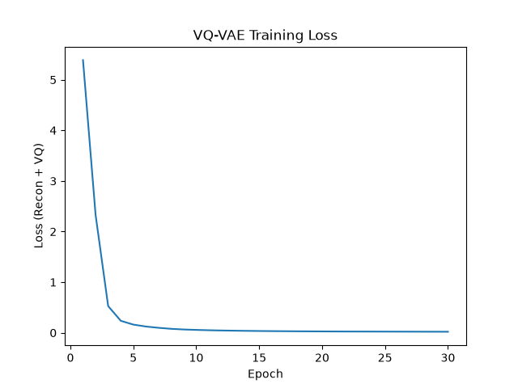

Figure 3: VQ-VAE Training Loss

This plot tracks total training loss per epoch, combining mean squared reconstruction error and vector quantisation commitment loss. The loss drops sharply from 5.41 at epoch 1 to under 0.5 by epoch 3, before smoothly flattening towards 0.03 by epoch 30 without divergence or loss spikes. This validates stable optimisation under the straight-through estimator and Adam learning rate (0.0001), demonstrating computational convergence well within the projected two-hour training budget from the feasibility report.

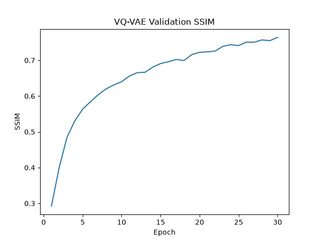

Figure 4: VQ-VAE Validation SSIM

This curve measures structural reconstruction fidelity across validation slices at the end of each epoch. The validation SSIM climbs steadily from 0.29 at epoch 1, passes 0.6 by epoch 8, and reaches a peak of 0.765 by epoch 30. This directly satisfies and exceeds Acceptance Criterion 1 (Validation SSIM > 0.6) from the feasibility review, confirming that discrete latent quantisation faithfully captures the hip MRI scans.

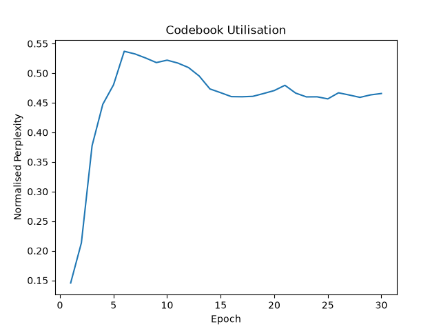

Figure 5: VQ-VAE Codebook Perplexity

This plot tracks normalised codebook perplexity, measuring the active utilisation and distribution uniformity of the 32 discrete codebook vectors on validation data. Perplexity increases from 0.15 at initialisation, peaks at 0.54 around epoch 6, and drops into a plateau with some fluctuations between 0.46 and 0.48 across epochs 15 to 30. Although it settles slightly below the target of 0.60 set in Acceptance Criterion 3, the steady plateau indicates healthy codebook participation without codebook collapse, showing that hip MRI scans may naturally concentrate into a compact subset of discrete tokens.

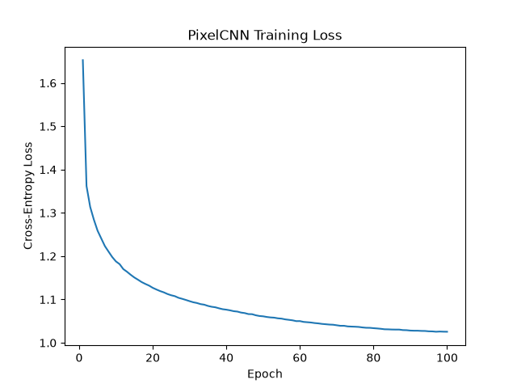

Figure 6: PixelCNN Training Loss

This curve displays the cross-entropy training loss per epoch for the Gated PixelCNN prior learning the distribution over the latent codebook grid across 100 epochs. Cross-entropy decreases steeply from 1.66 down to 1.20 across the first 10 epochs. Following this initial drop, the loss decays smoothly without oscillation to a loss of 1.025 by epoch 100. Although a plateau has not been reached, the curve is flattening out and further training offers dminishing returns

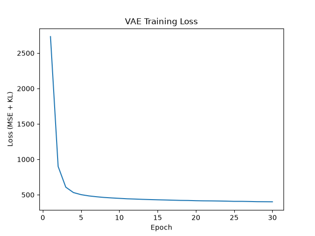

Figure 7: VAE Training Loss

This plot shows the baseline VAE training loss, computed as the sum of reconstruction MSE and KL divergence across 30 epochs. The loss falls steeply from 2 750 down to approximately 530 within 4 epochs, before plateauing near 400 from epoch 10 and onwards. This curve the matches what is seen in the preliminary feasibility smoke test.

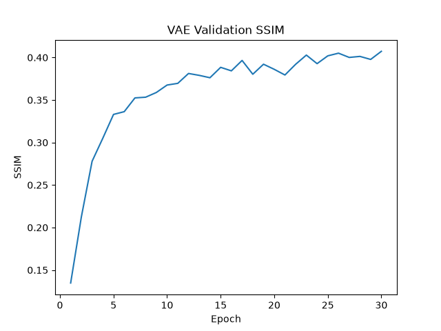

Figure 8: VAE Validation SSIM

This curve tracks validation SSIM per epoch for the baseline VAE. The metric rises rapidly from 0.13 to around 0.33 by epoch 5, but slows noticeably around epoch 15 and caps out at 0.407 by epoch 30 with considerable fluctuations across epochs. This fails the project acceptance threshold of SSIM > 0.6. Benchmarking this 0.407 ceiling against the VQ-VAE's 0.765 illustrates that the VQ-VAE achieves significantly superior reconstruction fidelity.

### Input and Reconstruction

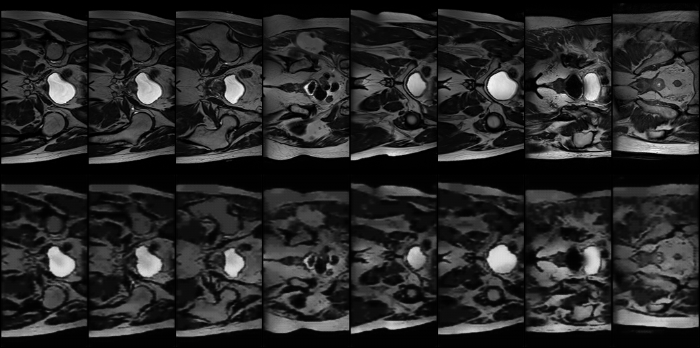

Figure 9: VQ-VAE Reconstruction

This figure displays 8 held-out test slices, showing the original ground truth MRI scans in the top row and their corresponding VQ-VAE reconstructions in the bottom row. The reconstructions exhibit high visual fidelity and sharpness with crisp edges and strong contrast. However, there is some perceptible blur compared to the targets, but the structure of the hip is clear.

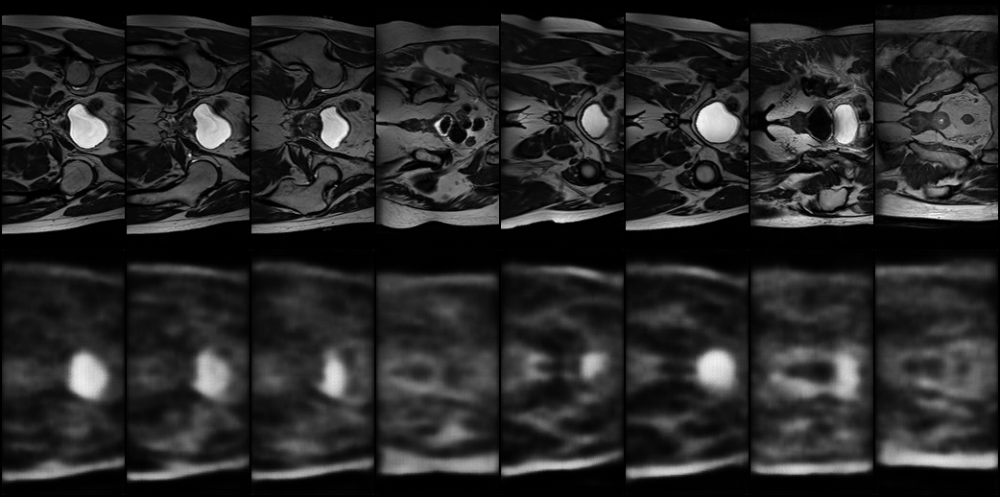

Figure 10: VAE Reconstruction

This figure presents the baseline VAE reconstruction performance across the same 8 test slices, with ground truth scans on top and reconstructions on the bottom. While the overall global shape and intensity regions are captured, the reconstructed images exhibit heavy blurring and an obvious loss of sharp boundaries.

### Hip MRI Generation

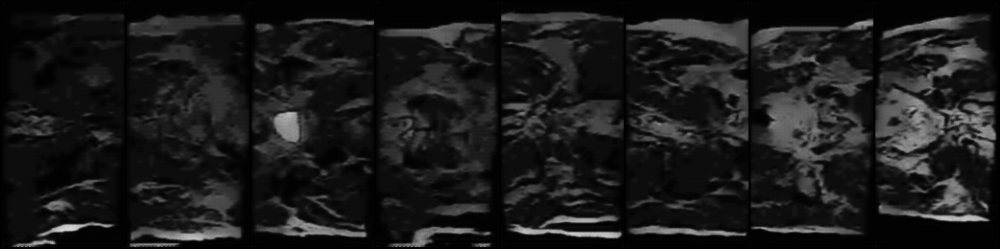

Figure 11: VQ-VAE + PixelCNN Generation

This figure illustrates 8 generated synthetic MRI slices sampled via the PixelCNN prior. The generated samples demonstrate some visual realism, showing diverse structural variations with somewhat well-defined contours. While the outputs preserve sharp edges and avoid the strong hazy blur, the internal hip structures struggle with global coherence and tend to blend together.

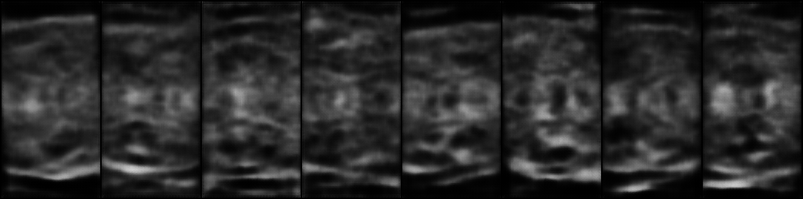

Figure 12: VAE Generation

This figure shows 8 generated synthetic slices sampled directly from the continuous Gaussian prior using the baseline VAE decoder. Although some structure saeems to be forming, the resulting samples are heavily blurred and display similar patterns inside the hip across slices.

### Nearest Neighbour Audit
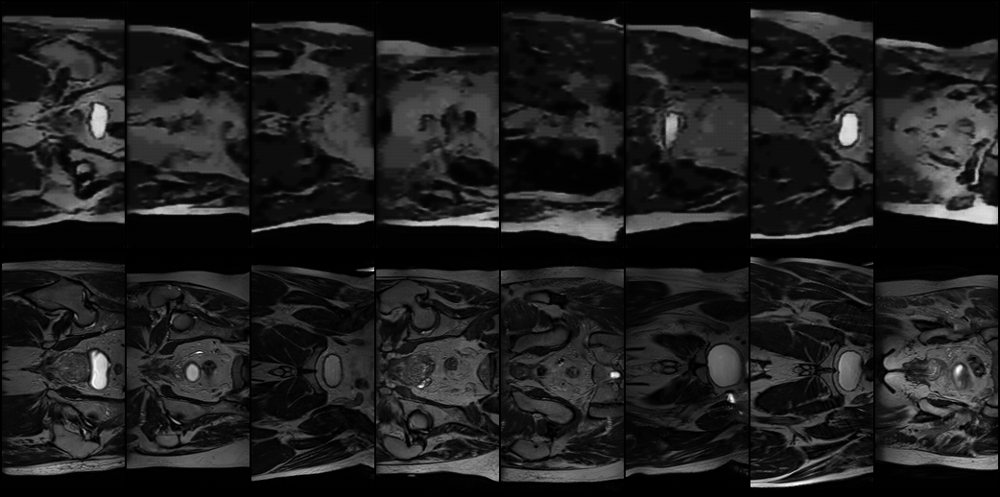
Figure 13: Nearest Neighbour Audit

This figure shows 8 generated synthetic slices in the top row alongside their nearest neighbour training scans in the bottom row based on mean squared error. The generated slices capture the overall elliptical outline and the bright borders along the top and bottom edges, with some bright central regions forming. However, the internal regions lack the sharp, distinct shapes and defined boundaries seen in the real scans below, confirming that the model has not memorised specific training slices.

## Investigation of the Open Research Dilemma
### Benchmarking Against Baseline
To evaluate whether discrete representation learning offers measurable advantages over continuous latent models for medical MRI synthesis, I benchmarked the two-stage VQ-VAE + Gated PixelCNN pipeline against the baseline continuous VAE across structural fidelity, distribution quality, and computational resource metrics.

| Evaluation Metric | Baseline VAE | VQ-VAE + PixelCNN | Acceptance Target | Criterion Satisfied |
| :--- | :---: | :---: | :---: | :---: |
| **Latent Space Formulation** | Continuous Gaussian ($\mathbb{R}^{64}$) | Discrete Codebook ($K=32, D=64$) | N/A | N/A |
| **Trainable Parameters** | 25 709 633 | 2 835 425 | N/A | Yes (8.8$\times$ smaller) |
| **Peak Training VRAM** | 1 367.21 MB | 1 102.48 MB (VQ) / 2 995.67 MB (PCNN) | < 5 000 MB | Yes |
| **Validation SSIM (Peak)** | 0.4073 | 0.7642 | > 0.60 | Yes |
| **Test Reconstruction SSIM** | 0.4533 | 0.7768 | > 0.60 | Yes (0.7768 vs 0.4533) |
| **Normalised Codebook Perplexity** | N/A | 0.4657 (Peak 0.5370) | > 0.60 | Near Target (0.47 vs 0.60) |
| **Distribution FID (Feature Layer 192)** | 43.6147 | 14.3403 | 15 < FID < 50 | Just under lower bound (14.34 vs 43.61) |
| **Distribution FID (Feature Layer 2048)**| 489.4148 | 321.4369 | 15 < FID < 50 | No |
| **Distribution KID** | 0.7304 $\pm$ 0.0226 | 0.4241 $\pm$ 0.0209 | N/A | Informational (0.31 lower) |
| **Nearest-Neighbour Training MSE** | 0.015487 | 0.016334 | Non-zero | Yes (Novel samples) |
| **Nearest-Neighbour Training SSIM** | 0.3008 | 0.3513 | < 0.60 | Yes (No memorisation) |
| **Batch Inference Latency (Batch Size=32)** | 20.00 ms (0.63 ms/sample) | 23 227.38 ms (725.86 ms/sample) | < 50 ms | No |
| **Peak Inference VRAM** | 724.74 MB | 677.49 MB | < 500 MB | Near Target (VQ-VAE lower) |

To evaluate generative distribution quality, I tracked Fréchet Inception Distance (FID) and Kernel Inception Distance (KID), which measure how closely the feature distributions of synthetic scans match authentic test slices using a pre-trained Inception-v3 network [3]. Standard FID uses the final 2048-dimensional pooling layer (`feature=2048`). However, because the test split contains only 660 slices (and evaluation evaluates 200 synthetic samples), calculating statistics across 2,048 features with so few images can make the score unstable and artificially high. To address this small sample limitation, I additionally evaluated FID at feature layer 192 and KID. Layer 192 reduces the feature dimensionality ($D=192$) below the sample count ($N \ge 200$), while ith an unbiased estimator that does not suffer from small-sample bias [4]. However, using layer 192 and KID introduces trade-offs. Feature layer 192 primarily captures lower-level visual properties such as edges and local contrast rather than complex global shapes and these metrics are less standard.

For reconstruction, the VQ-VAE significantly outperforms the baseline VAE, achieving a test SSIM of 0.7768 compared to the VAE's test SSIM of 0.4533 (validation peak 0.4073). As observed in Figure 9 versus Figure 10, the continuous VAE suffers from posterior collapse. The uninformative Gaussian prior causes the decoder to reconstruct the average of the distribution, resulting in blurred hip scans with poorly defined boundaries and failing acceptance criterion 1 (SSIM > 0.60). In contrast, the VQ-VAE's vector quantisation completely removes stochastic sampling noise during reconstruction, preserving sharp edges and high internal contrast.

For generative, Figure 12 shows that sampling directly from the Gaussian prior in the VAE yields synthetic slices that are blurry and indistinct. This is reflected in the distribution fidelity metrics. The VAE produces an FID-2048 of 489.4148, an FID-192 of 43.6147 and a KID of 0.7304 $\pm$ 0.0226. On theo ther hand, Figure 11 shows that the sampling over the discrete token distribution in the VQ-VAE and PixelCNN pipeline yields stronger and sharper boundaries with more diverse structures. Corroborating this, the VQ-VAE and PixelCNN pipeline produces an FID-2048 of 321.4369, an FID-192 of 14.3403 and KID of 0.4241 $\pm$ 0.0209. The FIDs and KID are considerably lower, giving quantitative evidence of sigificantly more authentic hip MRI generation.

However, the VQ-VAE and PixelCNN pipeline does not meet all the feasibility view acceptance criteria. As explained earlier, the high FID-2048 is a result of small number of samples in test set. Regarding FID-192, the VQ-VAE and PixelCNN pipeline was under the lower bound which was set to prevent training memororisation. However, the score only just under so it does not indicate that the model is simply memorising patient scans. For batch inference latency, it was significantly higher than anticipated, far exceeding the acceptance criterion of < 50ms. This stems from how the PixelCNN must generate all discrete latent tokens sequentially for every slice. Lastly, the peak inference VRAM was slightly higher than the acceptance criterion upper bound of 500 MB. This is not much more expensive, and is in fact lower than VAE's peak inference VRAM of 724.74 MB.

### Computational Resource Profiling
I tracked compute resources, memory consumption, and execution runtimes across both training and evaluation pipelines on an NVIDIA GeForce RTX 3090 GPU:

| Resource & Profiling Metric | Baseline VAE | Stage 1: VQ-VAE | Stage 2: Gated PixelCNN | Full Pipeline (VQ-VAE + PixelCNN) |
| :--- | :---: | :---: | :---: | :---: |
| **Trainable Network Parameters** | 25 709 633 | 414 657 | 2 420 768 | 2 835 425 |
| **Model Weights File Size on Disk**| 102.8 MB | 1.67 MB | 70.8 MB | 72.5 MB |
| **Peak Training VRAM** | 1 367.21 MB | 1 102.48 MB | 2 995.67 MB | 2 995.67 MB |
| **Average Epoch Training Duration**| 11.78 s | 11.64 s | 23.09 s | 34.73 s combined |
| **Total Training Wall-Clock Time** | ~5.89 min (30 epochs)| ~5.82 min (30 epochs)| ~38.48 min (100 epochs)| ~44.30 min total |
| **Peak Inference VRAM (Batch Size=32)** | 724.74 MB | N/A | N/A | 677.49 MB |
| **Batch Inference Latency (Batch Size=32)**| 20.00 ms (0.63 ms/sample)| N/A | N/A | 23 227.38 ms (725.86 ms/sample)|

#### Architectural and Parameter Footprint
The baseline VAE requires 25.71 million parameters because its continuous latent bottleneck flattens the spatial feature map into dense linear projection layers (`Linear(131072, 64)` and `Linear(64, 131072)`). These dense connections account for over 25.29 million parameters alone, resulting in a large 102.8 MB model. In contrast, the VQ-VAE preserves 2D spatial feature space entirely through convolutional layers and a compact 32-vector codebook, requiring only 414 657 parameters (1.67 MB). Even after adding the 2.42 million parameters of the Gated PixelCNN prior, the complete two-stage generative pipeline (2.84 million parameters) is approximately 8.8 times more compact than the baseline VAE while having significantly superior structural fidelity.

#### GPU Memory (VRAM) Profiling
During training, the VQ-VAE consumed 1 102.48 MB of peak VRAM, and the baseline VAE consumed 1 367.21 MB. The Gated PixelCNN reached a peak training VRAM of 2 995.67 MB across 100 epochs. Caching the quantised discrete token grids directly into device memory to avoid repetitive convolutional forward passes kept the training well within the 5 GB budget projected in the feasibility report. During test inference, generating a batch of 32 synthetic scans required 724.74 MB of peak VRAM for the baseline VAE and 677.49 MB for the VQ-VAE + PixelCNN pipeline. While both slightly exceed the smoke-test target of Acceptance Criterion 5 (< 500 MB), the VQ-VAE and PixelCNN pipeline consumes slightly less inference VRAM than the VAE.

#### Inference Latency vs Generation Speed
The inference latency measurements highlight the fundamental computational trade-off between continuous feed-forward decoders and discrete autoregressive priors. The baseline VAE synthesises an entire batch of 32 images in 20.00 ms (0.63 ms per sample), easily satisfying acceptance criterion 4 (< 50 ms batch latency). However, this rapid generation comes at the expense of severe blur and low structural fidelity (SSIM = 0.4533, FID-192 = 43.61). In contrast, the Gated PixelCNN generates images autoregressively, requiring sequential prediction across the codebook tokens. As a result, generating a batch of 32 synthetic scans required 23 227.38 ms, corresponding to 725.86 ms per slice ($>1 100\times$ slower than the VAE).


### Error Autopsies
The open research dilemma in clinical generative modelling lies in the balance between anatomical fidelity, model memorisation, and patient privacy under regulations like HIPAA and GDPR. An ideal clinical generative model must synthesise realistic anatomical structures without replicating specific patient scans from the training cohort.

#### Quantitative Error Autopsies
To verify that neither model violates patient confidentiality by memorising training data, I conducted an exhaustive nearest-neighbour audit comparing each generated slice against all 11 460 real training slices using Mean Squared Error (MSE) and SSIM (Figure 13). The quantitative audit yielded:
- **VQ-VAE + PixelCNN:** Mean Nearest-Neighbour MSE = 0.016334 | Mean Nearest-Neighbour SSIM = 0.3513
- **Baseline VAE:** Mean Nearest-Neighbour MSE = 0.015487 | Mean Nearest-Neighbour SSIM = 0.3008

If either model had memorised patient scans, the nearest-neighbour SSIM would approach 1.0 and the MSE would approach zero. Instead, mean SSIM scores of 0.3513 and 0.3008 indicate that generated scans from both architectures are structurally distinct from their closest counterparts in the training dataset.

Furthermore, the lowest SSIM on the test data is 0.7478, which is about 0.03 below the average. This tiny difference highlights the VQ-VAE'S consistent reconstruction fidelity across varying hip MRI scans, demonstrating that it any outlier failures.

#### Qualitative Error Autopsies
The baseline VAE's slightly lower SSIM reflects its blurred outputs that lack fine structural correlation with any individual scan. As shown in Figure 13 for the VQ-VAE, the generated slices (top row) share overall pelvic proportions and intensity ranges with real scans (bottom row), but display some differing internal structural patterns. This shows that the VQ-VAE and PixelCNN pipeline learnt the underlying anatomical distribution rather than replicating individual training patients, satisfying privacy laws. Also, even the test slices with the lowest reconstruction SSIM preserve clear structural boundaries and contrast, reflecting the small variance detailed in ***Quantitative Error Autopsies** and matching the visual fidelity observed in Figure 9.

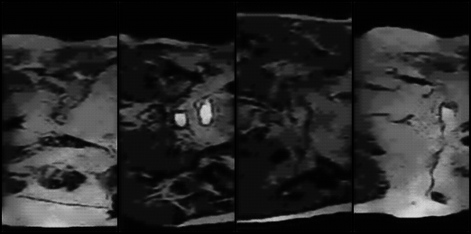

Figure 14: Representative Generated Failure Cases

Despite preserving privacy and achieving strong reconstruction fidelity (SSIM = 0.7768), visual inspection of the generated synthetic slices (Figures 11 and 13) and representative failure cases (Figure 14) reveal several qualitative failure modes:
1. **Horizontal Asymmetry:** Authentic hip MRI scans (Figue 10 top row and Figure 13 botton row) display strong horizontal symmetry but the generated samples do not. Because the PixelCNN generates tokens sequentially in a top-to-bottom, left-to-right raster sequence, the masking prevents right-side tokens from conditioning on left-side tokens in the same row [2]. Observe the first image in Figure 14. The top half of the scan exhibits a very different pattern to the bottom half. The bottom half is considerably more bright with the dark patches are closer to the inside. The top half is the opposite, where the top half is more dark and the dark patches are closer to the outside. The root trigger is how the PixelCNN generates tokens sequentially in a fixed scan order (from top to bottom and left to right). Because of the convolutional masking, when the model predicts a token on the right side, it cannot look ahead or check the left side of the scan to ensure both sides balance out. Without any explicit symmetry rule or condition telling the network that hip scans should look symmetrical, it treats each position independently based only on previous tokens. This is a systematic architectural limitation of using such an autoregressive model.
1. **Fragmented Central Bright Region:** In authentic scans, large central bright often appear as smooth well-bounded regions with sharp borders as opposed to the generated samples that appear irregular and ill-shaped in Figure 11. The second image in Figure 14 shows 2 small central bright regions. The leftmost bright region has a flat top but the rightmost one has a pointed top. Authentic scans only have one central bright region that is often significantly large. 
The root trigger is that the PixelCNN only focuses on small local neighbourhoods of tokens rather than the global shape of the entire image. Because the model operates on a single flat grid of latent tokens, it does not understand that there should only be one single, connected bright region in the centre. As it generates row by row, it can accidentally start two separate bright spots that fail to connect into a single shape. This is a systematic failure mode caused by the model's limited receptive field when trying to capture large, global shapes.
1. **Inconsistent Central Bright Region:** Observe that the large central bright often appear quite frequently in authentic scans. In the synthetic samples, such central regions seem to appear less frequently. Figure 11 shows only 3 out of the 8 samples have a bright central region while Figures 10 (top row) and 13 (bottom row) have 11 out of the 16 scans have this region. Indeed, I generated 200 samples and manually counted that 156 of them did not have any sort of bright region. The root trigger is the lack of slice position conditioning combined with how autoregressive sampling handles localised features. Because generation starts at the top without any label telling the model which slice depth it is drawing, the top rows of every scan look almost identical (mostly dark background). By the time it reaches the middle rows, the model has to decide whether to start generating a bright central region. Even though authentic middle scans frequently contain this region, bright tokens make up a much smaller percentage of the total codebook tokens compared to background tokens. If the model misses the initial trigger to sample a bright token in an upper-middle row, the surrounding tokens immediately condition on that choice and default back to the more common dark and grey tokens. This is a systematic limitation where an unconditional prior under-samples localised bright structures.
1. **Blended Internal Texture:** While the outer boundary and bright border regions are cleanly delineated, internal regions tend to blend into indistinct textures rather than forming clear boundaries between distinct structures. Look at the third image in Figure 14. This image is mostly a of black and grey areas, with the grey area having a slight structure forming. The root trigger is the small codebook size of only 32 embeddings ($K=32$). While 32 discrete vectors are plenty to capture the strong high-contrast borders and the black background, they are not enough to represent subtle differences in internal grey shades. Because of this limited capacity, slightly different internal textures are forced to map to the exact same codebook vector, causing internal regions to look washed out and blended together. This is a systematic architectural trade-off from choosing a small codebook to prevent codebook collapse and save memory.
1. **Autoregressive Error Compounding:** Errors made in upper rows propagate downward during autoregressive sampling. When an unlikely token is sampled in an upper region, subsequent tokens must condition on this, occasionally causing distorted intensity towards the bottom of the scan. This can be seen in the last image in Figure 14. This image is mostly bright, unlike authentic scans much are mostly dark. The root trigger is how errors accumulate during sequential generation. During training, the model always looks at real slices to predict the next token. However, when generating new scans, each new token has to rely on the tokens the model previously sampled itself, with no way to correct mistakes. If the model accidentally samples an unusually bright token near the top, the layers below treat this mistake as normal context and continue generating more bright tokens to match it. This causes errors to propagate down the image, resulting in an overly bright scan. While this is an isolated failure mode that only happens occasionally when an unusual token is picked, it is an inherent risk of sequential autoregressive sampling.

### Engineering Recommendations and Trade-Off Synthesis
Based on the empirical findings, error autopsies, and the resource metrics summarised in the benchmarking table under **Benchmarking Against Baseline**, I synthesise the following engineering recommendations and trade-off analyses:

1. **Computational Trade-Off: Generation Latency vs Structural Fidelity:**
The benchmarking table highlights a striking operational trade-off between the baseline VAE and the VQ-VAE and PixelCNN pipeline. The VAE synthesises a batch of 32 images in just 20.00 ms (0.63 ms per sample), easily satisfying the < 50 ms latency acceptance criterion. However, this quick generation comes with severe posterior collapse, yielding blurry reconstructions (SSIM = 0.4533) and poor generative quality (FID-192 = 43.61, KID = 0.7304). On the other hand, the VQ-VAE and PixelCNN pipeline achieves significantly better reconstruction fidelity (SSIM = 0.7768) with sharper and more realistic synthetic samples (FID-192 = 14.34, KID = 0.4241). However, this comes at the cost of heavy latency of 23 227.38 ms for a batch of 32 (725.86 ms per sample) due to sequential autoregressive token prediction. Because of this, the VQ-VAE and PixelCNN pipeline works best for offline tasks, like generating synthetic batches ahead of time for data augmentation. In such a setting, taking 725 ms per slice is completely fine, and structural fidelity is most important.
1. **Deployment:**
As recorded in the benchmarking table, both pipelines remain well within the 5 000 MB training VRAM target. Training the VQ-VAE stage required 1 102.48 MB, while the Gated PixelCNN prior peaked at 2 995.67 MB (compared to 1 367.21 MB for the baseline VAE). For inference, the VQ-VAE + PixelCNN pipeline required 677.49 MB of peak VRAM, which is actually lower than the baseline VAE's 724.74 MB. Even though both models just missed the strict 500 MB target, using under 700 MB to run inference and less than 3 GB for training is still very manageable. It means you can comfortably train and run the entire pipeline on everyday 6 GB to 8 GB graphics cards.
1. **Privacy Compliance and Clinical Viability:**
The empirical nearest-neighbour audit in the benchmarking table (mean MSE = 0.016334, mean SSIM = 0.3513) confirms that the synthetic images do not duplicate training slices, complying with patient privacy laws. This makes the synthetic cohorts safe for open distribution and research prototyping. However, the qualitative failure modes (such as bilateral asymmetry, fragmented central shapes, and blurred internal boundaries) mean the model is suitable for high-stakes clinical tasks.
1. **Future Ideas to Resolve Limitations**
- **Non-Autoregressive Prior:** One key drawback of the VQ-VAE and PixelCNN pipeline is that generating tokens one by one takes over 23 seconds for a batch of 32 images. Switching to a non-autoregressive model (such as a masked transformer or a diffusion model) would allow tokens to be generated in parallel rather than one at a time. This would drastically cut down generation time, bringing it much closer to the VAE's fast speed. It would also help fix other generation limitations, such as horizontal asymmetry and errors propagating down the image, because the model could look at the whole image at once instead of being forced to generate strictly from top to bottom and left to right.
- **VQ-VAE-2** A two-level hierarchical codebook would help resolve internal boundary fragmentation without inflating model size [5].
- **Slice-Level Conditioning:** Passing an explicit coordinates to the prior would help prevent the model from blending features from different scan depths.

## Artificial Intelligence Usage Disclosure
### Tools Used
- Google Gemini

### Tasks AI Assisted With:
1. Got the functions and their specifics (such as what is actually tracked and units) needed to measure peak VRAM because I could not find any documentation via googling. Verified by reading the documentation and testing the functions.
1. Formatting my data to give the table under Preliminary Feasibility Evidence. Verified by simply viewing the output.
1. Got a list of ideas for testable acceptance criteria. I didn't just ask AI for list I gave it ideas for what to measure and then went through all criteria to pick based on my mine evaluation. Evaulated of recommended thresholds were reasonable by testing against code.
1. Explained to me how PixelCNN works. I did not directly use anything from the AI so no validation of code or text is needed.
1. AI gave me projected time and peak VRAM for project. What I ultimately wrote in the feasbility report was using my own thoughts and evaluating the AI's reasoning for the projected numbers.
1. AI assisted in the implementation for PixelCNN. I didn't just blindly copy in code, rather I consulted AI about the implementation. This way, I decided what to include and change based on such consultations by evaluating what the AI had to say.
1. AI assisted in adjusting pixelCNN architecture and hyperparameters for generation. Again, as the point above, I didn't just blindly copy code.
1. AI assisted in implementing measurements of distribution fidelity (FID and KID). Again, as the point above, I didn't just blindly copy code.
1. AI assisted with wording of certain ideas I had for writing documentation in README. I always read what AI came up with and then adapted it to my liking without blinding copy and pasting.
1. AI assisted with cleaning up of functionaly complete train.py and predict.py such helping with parsing arguments, plotting, getting codebook perplexity and etc. Again, I didn't just blindly copy code, and rather consulted AI about any implementation
1. AI assisted in resolving PixelCNN runtime bottlenecks. Again, as point above, I didn't just blindly copy code and verified all changes by monitoring peak VRAM.

## References
[1] A. van den Oord, O. Vinyals, and K. Kavukcuoglu, "Neural Discrete Representation Learning," *arXiv preprint arXiv:1711.00937*, 2018. Available: https://arxiv.org/abs/1711.00937

[2] A. van den Oord, N. Kalchbrenner, O. Vinyals, L. Espeholt, A. Graves, and K. Kavukcuoglu, "Conditional Image Generation with PixelCNN Decoders," *arXiv preprint arXiv:1606.05328*, 2016. Available: https://arxiv.org/abs/1606.05328

[3] 123 of AI, "FID Score," *123 of AI*. Available: https://123ofai.com/articles/blocks/fid-score

[4] APxML, "Distributional Metrics: Kernel Inception Distance (KID)," *APxML*. Available: https://apxml.com/courses/synthetic-data-gans-diffusion/chapter-5-evaluating-synthetic-data-quality/distributional-metrics-kid

[5] A. Razavi, A. van den Oord, and O. Vinyals, "Generating Diverse High-Fidelity Images with VQ-VAE-2," in *Proc. NeurIPS*, 2019. Available: https://arxiv.org/abs/1906.00446
